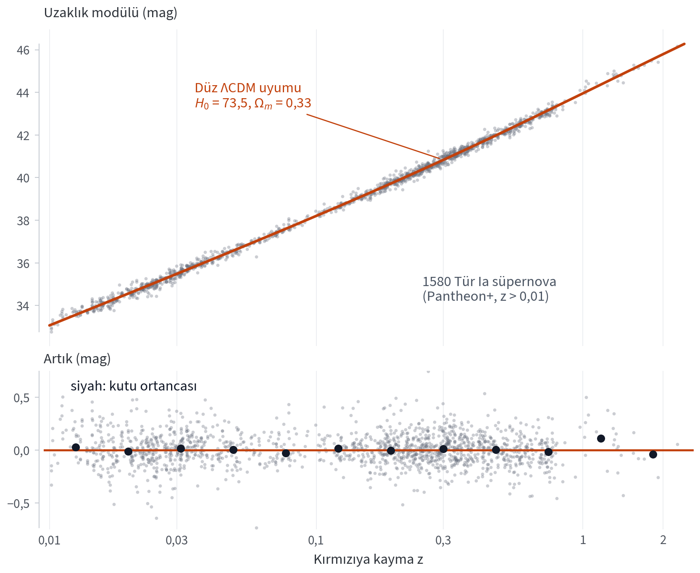
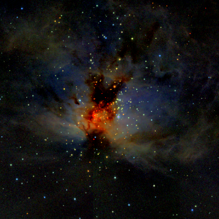
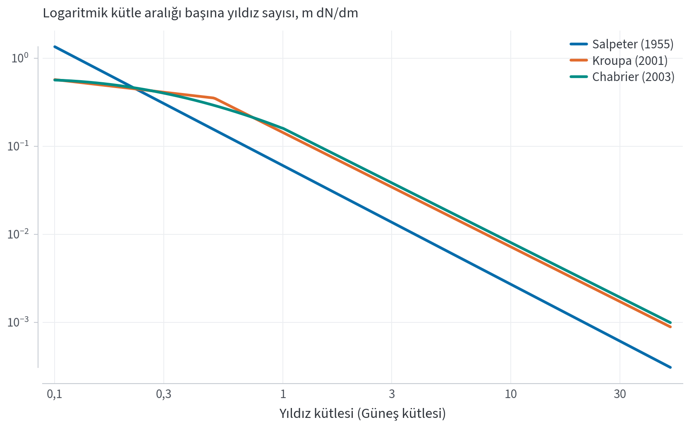

# astrostuff

`kozmos`: gökbilim ve astrofizik hesapları için sıfırdan yazılan bir Python kitaplığı. Tek bir kuralı var:

> **Her fonksiyon, uyguladığı denklemin yayımlanmış kaynağını gösterir ve bağımsız bir hesaba karşı sınanır. Kaynağı olmayan fonksiyon testten geçemez.**

Kitaplık çalışırken yalnızca NumPy ve SciPy kullanır. Astropy ve ERFA hesap için değil, sonuçları karşılaştırmak için vardır.

- 205 fonksiyon, 35 sabit, 971 test
- 244 kaynak kaydının 228'inde denklem kaynağın metninden okundu; 16'sı açıkça "bekliyor" işaretli
- Güncel sayılar: [plan/DURUM.md](plan/DURUM.md) (koddan üretilir)

## Kitaplıkla üretilen sonuçlar

Aşağıdaki şekillerin hepsi bu depodaki kodla, açık veriden ya da doğrudan fonksiyon çıktısından üretilmiştir. Üreten betikler [ornekler/](ornekler/) ve [projeler/](projeler/) klasörlerindedir.

### Hubble sabiti: Pantheon+ süpernovaları



Kod açık [Pantheon+SH0ES verisini](https://github.com/PantheonPlusSH0ES/DataRelease) indirir, 1701 × 1701 kovaryans matrisiyle olabilirliği kurar ve kendi yazdığımız MCMC örnekleyicisiyle parametreleri kestirir. Bulunan değerler yayımlananları yeniden üretir:

- Madde yoğunluğu: **Ωm = 0,332 ± 0,018** (yayımlanan 0,334 ± 0,018)
- Hubble sabiti: **H0 = 73,53 ± 1,00 km s⁻¹ Mpc⁻¹** (yayımlanan 73,6 ± 1,1)

Yayımlanan değerler Brout ve ark. (2022) makalesinin arXiv kaynağından okundu. Bulunan H0 belirsizliği yayımlanandan küçüktür; nedeni henüz incelenmedi. Kayıt: [projeler/hubble/sonuc.json](projeler/hubble/sonuc.json).

### Yıldız kataloğu: Gaia ile Güneş çevresi


Güneş'e 50 parsekten yakın 31 298 yıldız anakol, beyaz cüce dizisi ve dev kolunda toplanıyor. Katalog Gaia DR3'ten kendi yazdığımız TAP istemcisiyle indirilir (paralaks sinyal-gürültü oranı > 20, RUWE < 1,4). Gaia çok parlak yıldızlarda doyduğu için en parlak yıldızlar örneklemde yoktur.

### Aynı alan, üç dalga boyu: optik ve kızılötesi


Alev Bulutsusu'nda (NGC 2024) toz, görünür ışıkta yıldızları gizler; 2 µm'de aynı alanda saptanan kaynak sayısı 17'den 132'ye çıkar. 12 µm'de ısınmış tozun kendi ışıması görünür; ortadaki siyah bölge görüntüdeki en düşük değerli piksellerdir ve büyük olasılıkla dedektörün doyduğu alandır (doğrulanmadı). Görüntüler NASA SkyView'dan indirilir, kendi FITS okuyucumuzla okunur; arka plan haritası ve kaynak saptama `kozmos.fotometri` ile yapılır.



Aynı alanın 2MASS J, H ve K bantlarından renk koruyan bileşimi (Lupton ve ark. 2004 germesi). Toz şeridinin içindeki kırmızı yıldızlar K bandında J bandına göre çok daha parlaktır; bu, tozun içinden gelen ışığın kızarmasıyla uyumludur.

### Kara delikler, yıldızlar, yıldız oluşumu


Kara delik döndükçe en içteki kararlı yörünge 6'dan 1,24 çekim yarıçapına iner ve yığılan maddenin ışınıma çevrilen kesri %5,7'den %32'ye çıkar (a* = 0,998).

<p>


</p>

Solda politrop yıldız modelleri: indis büyüdükçe yıldız merkezde yoğunlaşır (n = 3 için merkez yoğunluğu ortalamanın 54 katı). Sağda üç başlangıç kütle fonksiyonu, 0,1-50 Güneş kütlesi aralığında aynı toplam sayıya normalleştirilmiş: 1 Güneş kütlesinin üstünde eğimleri aynıdır, altında Salpeter çok daha fazla küçük yıldız öngörür.


Bir gaz bulutunun kendi çekimiyle çökebilmesi için gereken en küçük kütle. 10 K sıcaklıkta ve santimetreküpte 10⁴ parçacık yoğunluğunda yaklaşık 3 Güneş kütlesidir.

## Neler var

**Gözlem ve veri**

- `arsiv`: TAP istemcisi, Gaia DR3 yıldız örneklemleri, SkyView görüntü kesitleri (DSS2, 2MASS, WISE), Pantheon+ verisi; her indirme SHA-256 özetiyle kayda geçer
- `io`: FITS okuyucu ve yazıcı (FITS 4.0 standardından)
- `gozlem`: hedef görünürlüğü ve hava kütlesi, CCD sinyal modeli, sentetik ham kare, sinyal-gürültü oranı
- `indirgeme`: sigma kırpmalı kare birleştirme, bias/karanlık/düz alan düzeltmesi, kazanç ve okuma gürültüsü ölçümü
- `fotometri`: arka plan haritası, kaynak saptama, açıklık fotometrisi
- `gorsel`: asinh germe ve renk koruyan RGB bileşimi
- `isinim`: kadir sistemleri, Planck fonksiyonu, 2MASS ve WISE sıfır noktaları
- `zamanserisi`: Lomb-Scargle periyodogramı

**Astrofizik**

- `karadelik`: Schwarzschild ve Kerr yarıçapları, gölge boyutu, yığılma (Eddington, Bondi, ince disk), Hawking ışınımı, birleşen çiftlerin çekimsel dalga frekansı
- `yildiz`: Lane-Emden politropları, yıldız ölçekleme bağıntıları, Chandrasekhar kütlesi, başlangıç kütle fonksiyonları
- `yildizolusumu`: Jeans ve Bonnor-Ebert kütleleri, serbest düşme süresi, viryal parametre, Kennicutt-Schmidt yasası, Toomre Q
- `kozmoloji`: uzaklık ölçüleri, Hubble diyagramı olabilirliği
- `efemeris`: Kepler denklemi ve yörünge bağıntıları

**Altyapı**

- `temel`: CODATA 2022 sabitleri, IAU nominal değerleri, açı aritmetiği
- `zaman`, `koordinat`: Jülyen tarihi, artık saniyeler, yıldız zamanı, galaktik ve ufuk dönüşümleri
- `istatistik`: doğrusal uyum, MCMC, yakınsama tanıları, sağlam kestiriciler

## Kaynak kuralı nasıl işler

```python
@kaynak("Hogg1999", yer="Denk. 15", teyit="okundu")
def esyuruyen_uzaklik_mpc(z, kozmoloji):
    """Bakış doğrultusundaki eşyürüyen uzaklığı hesaplar.

    Kaynaklar
    ---------
    [Hogg1999] Denk. 15.

    Doğrulama
    ---------
    tests/kahin/test_kozmoloji_kahin.py
    """
```

- `teyit="okundu"`: denklem kod yazılırken kaynağın metninden alındı (arXiv TeX dosyası, standart belgesi, kaynak kodu).
- `teyit="bekliyor"`: denklem bilinen biçimiyle yazıldı ve testlerle sınandı, ama kaynağın metni henüz açılmadı.

Bir test her açık fonksiyon için kaydın varlığını, anahtarın [kaynakçada](kaynakca/) tanımlı olduğunu, belge dizgisinin aynı kaynağı andığını ve gösterilen test dosyasının var olduğunu denetler. Kaynakçadaki künyeler de sınanır: [kaynakca/dogrula.py](kaynakca/dogrula.py) her DOI'yi Crossref'e, her arXiv kimliğini arXiv'e sorar.

Kaynak metnini açmak sonucu değiştirdi. Okuma sırasında bulunanlardan üçü:

- Bir derleme makalesindeki Kerr foton yörüngesi formülü, basıldığı biçimiyle ileri değil geri yönlü yörüngeyi veriyor.
- Jeans kütlesinin iki yaygın tanımı arasında 4π/3 kat fark var; fonksiyon ikisini de adıyla sunuyor.
- Bir kaynaktaki politrop tablosunun kütle katsayısı sütunu yalnızca n = 3 için standart tanımla uyuşuyor.

Ayrıntılar [plan/04_fizik/08_kara_delik_yildiz_ve_yildiz_olusumu.md](plan/04_fizik/08_kara_delik_yildiz_ve_yildiz_olusumu.md) dosyasındadır.

## Kurulum ve kullanım

Python 3.12 ya da üstü gerekir.

```
pip install -e ".[dogrulama,gelistirme,gorsel]"
pytest -m "not ag"
```

```python
import numpy as np
from kozmos.kozmoloji.uzaklik import Kozmoloji, isinim_gucu_uzakligi_mpc
from kozmos.karadelik.temel import isco_isinim_verimliligi
from kozmos import kaynakca_raporu

isinim_gucu_uzakligi_mpc(np.array([0.1, 1.0]), Kozmoloji.duz(h0=70.0, omega_m=0.3))  # [460.30, 6607.66] Mpc
isco_isinim_verimliligi(0.0)                       # 0.0572: dönmeyen kara delikte yığılma verimi
print(kaynakca_raporu(isco_isinim_verimliligi))    # hangi yayına dayanıyor, okundu mu
```

Şekilleri yeniden üretmek için (veriyi kendileri indirir):

```
python projeler/hubble/hubble_analizi.py     # yaklaşık 12 dakika
python projeler/hubble/hubble_sekli.py
python ornekler/hr_diyagrami.py
python ornekler/optik_kizilotesi.py
python ornekler/fizik_galerisi.py
```

Şekil betikleri yerel `datawiz` şekil kitaplığını kullanır; o kitaplık bu depoda yoktur.

## Sınırlar

- Yeni yazılan fizik modülleri kendi testleriyle, kapalı çözümlerle ve kaynaklardaki sayılarla sınandı. Bağımsız bir kitaplıkla karşılaştırma zaman, koordinat, kozmoloji, istatistik, FITS ve periyodogram modüllerinde var.
- Gözlem planlaması presesyon, nutasyon ve kırılma içermez (hata yaklaşık 0,4 dereceye kadar).
- FITS okuyucu yalnızca birincil görüntü birimini okur; tablo ve uzantı desteği yok.
- Kaynak saptama örtüşen kaynakları ayırmaz; açıklık fotometrisi dar açıklıkta yüzde birkaç eksik ölçer.
- SkyView kesitleri yeniden örneklenmiş görüntülerdir; fotometrik kalibrasyon için özgün arşiv verisi gerekir.

## Plan

[plan/](plan/00_OKU_BENI.md) klasörü projenin tasarımını taşır: saha araştırması, matematik, fizik, veri bilimi, mimari, yol haritası ve işlev envanteri. Plan belgelerindeki denklemler planlama düzeyindedir; bir fonksiyon yazılırken denklem kaynağından alınır.

## Lisans

Telif Hakkı © 2026 Ayberk. Tüm hakları saklıdır; ayrıntı [LICENSE](LICENSE) dosyasındadır. Bazı fonksiyonların izlediği ERFA algoritmalarına ilişkin bildirim [UCUNCU_TARAF_BILDIRIMLERI.md](UCUNCU_TARAF_BILDIRIMLERI.md) dosyasındadır. Analizlerin kullandığı veri depoya konmaz; çalışma anında kaynağından indirilir. Şekillerin bir kısmı DSS2, 2MASS, WISE, Gaia ve Pantheon+ verisinden türetilmiştir; bu veriler kendi sahiplerinin koşullarına tabidir ve hak saklama onları kapsamaz.
