<p align="center">
  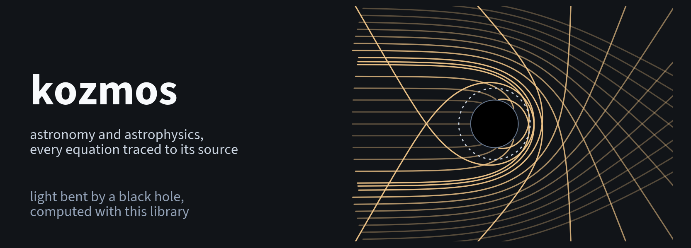
</p>

# astrostuff

`kozmos` is a Python library for astronomy and astrophysics, written from scratch: from reducing a raw telescope frame to integrating the orbit of light around a black hole. It follows one rule:

> **Every function cites the published source of the equation it implements and is tested against an independent calculation. A function without a source cannot pass the tests.**

The banner above is an example. The rays are null geodesics of the Schwarzschild metric, integrated by the library; the rule ties the metric and the geodesic equation to the pages they were read from, and the tests check the integration against the conservation laws it has to obey.

At run time the library uses only NumPy and SciPy. Astropy and ERFA are used to check results, not to compute them.

| | |
|---|---|
| **414** functions, **35** constants | every one with a source record; in all 476 records the equation was read from the text of the source |
| **3656** tests | run on every push ([CI](.github/workflows/ci.yml): Linux, Windows and macOS, Python 3.12 and 3.13) |
| **21** packages | from FITS files and photometry to Lagrangians, geodesics and dark energy |

Current numbers, generated from the code: [plan/STATUS.md](plan/STATUS.md).

## A first look

```python
import numpy as np
from kozmos.cosmology.distances import Cosmology, luminosity_distance_mpc
from kozmos.cosmology.dark_energy import acceleration_onset_redshift, age_gyr
from kozmos.relativity.weak_field import light_deflection_angle_rad
from kozmos.black_holes.basics import isco_radiative_efficiency
from kozmos import bibliography_report

universe = Cosmology.flat(h0=70.0, omega_m=0.3)
luminosity_distance_mpc(np.array([0.1, 1.0]), universe)  # [460.30, 6607.66] Mpc
age_gyr(0.0, universe)  # 13.47 Gyr
acceleration_onset_redshift(universe)  # 0.671: the expansion has been speeding up since then

np.degrees(light_deflection_angle_rad(1.98841e30, 6.957e8)) * 3600  # 1.751 arcsec at the limb of the Sun
isco_radiative_efficiency(0.0)  # 0.0572 for a non-rotating black hole

print(bibliography_report(isco_radiative_efficiency))  # which publication it rests on, whether it was read
```

The foundations are written the same way. A Lagrangian is an ordinary Python function; the library differentiates it, and Noether's theorem becomes something you can compute:

```python
from kozmos.mechanics import lagrangian, noether


def kepler(q, v, t):  # polar coordinates (r, phi), GM = 1
    return 0.5 * (v[0] ** 2 + q[0] ** 2 * v[1] ** 2) + 1.0 / q[0]


q, v = np.array([1.0, 0.0]), np.array([0.0, 1.2])
turn = lambda q, v, t: np.array([0.0, 1.0])  # shift phi
push = lambda q, v, t: np.array([1.0, 0.0])  # shift r

lagrangian.jacobi_function(kepler, q, v)  # -0.28: the energy
noether.symmetry_defect(kepler, q, v, 0.0, turn)  # 0.0: a symmetry, so its charge is conserved
noether.noether_charge(kepler, q, v, 0.0, turn)  # -1.2: minus the angular momentum (sign of the source)
noether.symmetry_defect(kepler, q, v, 0.0, push)  # 0.44: not a symmetry
```

## What the library computes

All the figures below were produced with the code in this repository, from open data or directly from function output. The scripts are in [examples/](examples/) and [projects/](projects/).

### Foundations: conservation laws that hold

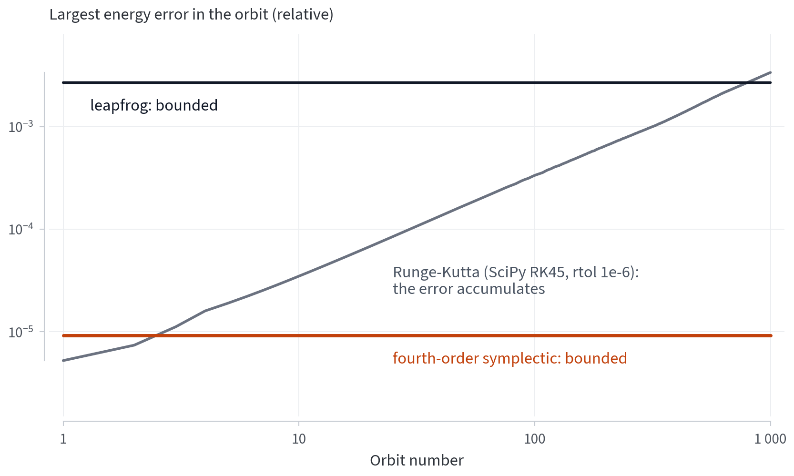

A planet on an ellipse of eccentricity 0.5, followed for 1000 orbits with 200 steps per orbit. The energy error of the two symplectic integrators does not grow: it stays at 2.7 × 10⁻³ for the leapfrog and at 9.2 × 10⁻⁶ for the fourth-order scheme, the same in the first orbit and in the last. A general-purpose Runge-Kutta solver (SciPy RK45 at a relative tolerance of 10⁻⁶, 280 force evaluations per orbit) starts lower, at 5 × 10⁻⁶, and ends at 3.4 × 10⁻³, because its error accumulates. Record: [energy_conservation.json](figures/energy_conservation.json).

The `mechanics` package holds the layer under everything else: Euler-Lagrange equations, the Legendre transform, Poisson brackets, Noether charges and the symplectic integrators. The advanced modules are checked against it. For the Kerr metric, the geodesic equation computed from Christoffel symbols equals the Euler-Lagrange equation of ½ g u u to 1.9 × 10⁻¹¹; the constants of motion that follow from the Killing vectors equal the Noether charges of the same Lagrangian; the Klein-Gordon equation of the scalar-field module follows from the Lagrangian a³(φ̇²/2 − V) ([test_foundations_cross_check.py](tests/unit/test_foundations_cross_check.py)).

### Gravity: orbits and light near a black hole

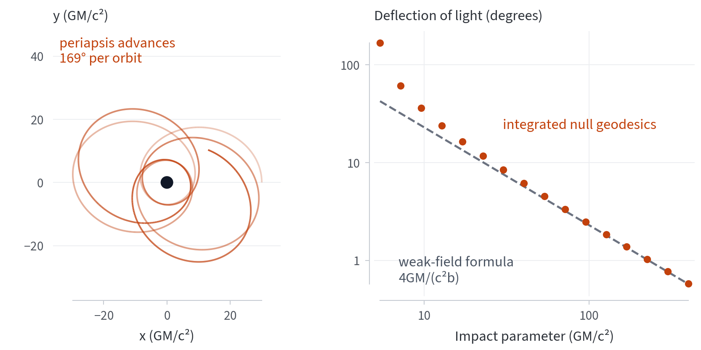

Left: an orbit between 7 and 30 gravitational radii of a non-rotating black hole. In Newtonian gravity it would be a closed ellipse; here the periapsis advances by 169° on every turn. The energy of the orbit is conserved to 1.2 × 10⁻¹¹ over the integration. Right: the bending of light. Far from the hole the integrated geodesics follow the weak-field formula 4GM/(c²b) (0.577° against 0.573° at an impact parameter of 400 gravitational radii); close to it the formula fails, and at 5.4 radii the ray is turned by 167° where the formula gives 42°. The same formula gives 1.751 arcseconds at the limb of the Sun, and the perihelion formula gives 42.98 arcseconds per century for Mercury. Record: [relativity_orbits.json](figures/relativity_orbits.json).

The metric is a Python function, so the same code integrates geodesics of Schwarzschild, Kerr, Reissner-Nordström and FLRW metrics, or of one you write yourself, and computes its Riemann, Ricci and Einstein tensors.


As the black hole spins, the innermost stable orbit falls from 6 to 1.24 gravitational radii, and the fraction of the accreting matter converted to radiation rises from 5.7% to 32% (a* = 0.998).

### The expanding universe: supernovae and dark energy

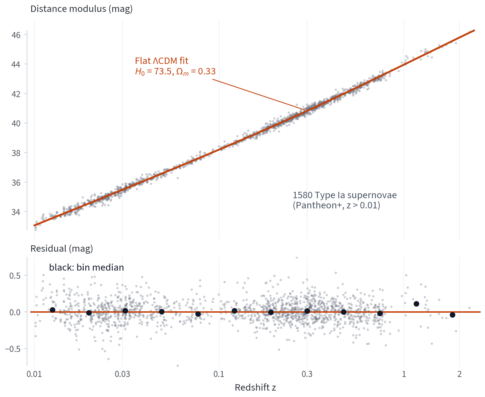

The code downloads the open [Pantheon+SH0ES data](https://github.com/PantheonPlusSH0ES/DataRelease), builds the likelihood with the 1701 × 1701 covariance matrix, and estimates the parameters with an MCMC sampler we wrote ourselves. The values it finds reproduce the published ones:

- Matter density: **Ωm = 0.332 ± 0.018** (published 0.334 ± 0.018)
- Hubble constant: **H0 = 73.54 ± 1.02 km s⁻¹ Mpc⁻¹** (published 73.6 ± 1.1)

The published values were read from the arXiv source of Brout et al. (2022). Record: [projects/hubble/result.json](projects/hubble/result.json). The chain is extended until the rank-normalized R̂ of every parameter is below 1.01 (the threshold of Vehtari et al. 2021) and the chain is longer than 50 autocorrelation times; it stopped at 5000 steps of 32 walkers with R̂ ≤ 1.007. An earlier 2000-step chain had R̂ up to 1.027 and gave ± 1.00.

<details>
<summary>Why our uncertainty is ± 1.0 while the paper quotes ± 1.1</summary>

The H0 uncertainty we find is smaller than the published one. Three independent checks support our value ([h0_uncertainty_check.py](projects/hubble/h0_uncertainty_check.py)):

- A closed-form solution that does not use a chain gives 73.52 ± 1.02 from the same data; with no redshift cut at all it gives 73.41 ± 1.01, with the cut raised to 0.023 it gives 73.70 ± 1.03; with the distance definition of the likelihood code in the data release (d_L = (1 + z_HEL) D_M) it gives 73.53 ± 1.02.
- All four chains (emcee) in the data release give a scatter between ± 1.01 and ± 1.04 after the first 10% is discarded; if the initial part is not discarded they give between ± 1.03 and ± 1.07. The flat ΛCDM chain gives 73.53 ± 1.01.
- The baseline result of Riess et al. (2022) is ± 1.01; the abstract of the same paper gives 73.30 ± 1.04 when high-redshift supernovae are added.

The paper quotes ± 1.1 for all four models; none of the published chains gives this value (to one decimal place they all round to ± 1.0). The paper names PolyChord as the sampler, while the chains in the data release are emcee. The configuration shown in the header of the published chain says this: the chain is an emcee run with 16 walkers, and all walkers start from the same point (this is where the wide scatter of the initial part comes from); a separate PolyChord output with 250 live points is defined for the same configuration (`122221_poly_P+SH0ES`), and the paper also says 250 live points. This output is not in the data release. The published data and the published likelihood code give ± 1.0, with or without a chain; the run that produces ± 1.1 has not been published, so the value cannot be reproduced from open data. The repository of the data release has an open record that asks the same question ([PantheonPlusSH0ES/DataRelease#16](https://github.com/PantheonPlusSH0ES/DataRelease/issues/16), 27 October 2026; unanswered on 25 November 2026).

</details>

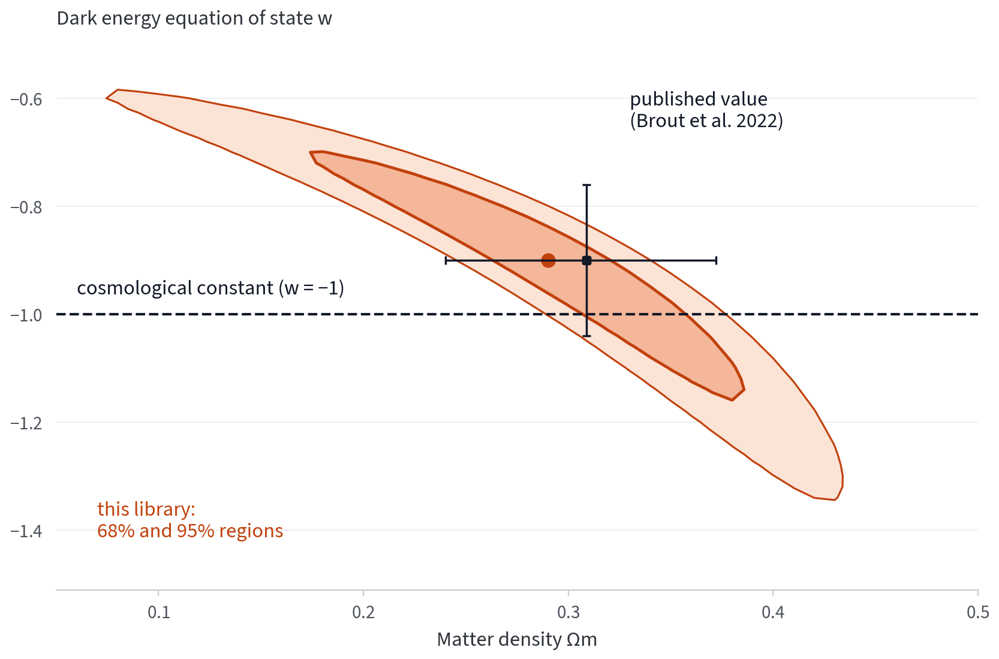

Is dark energy a cosmological constant? With its equation of state left free (flat wCDM, supernovae only, absolute magnitude marginalized), a grid over (Ωm, w) gives:

- **w = −0.91 (+0.14, −0.16)** (published −0.90 ± 0.14)
- **Ωm = 0.298 (+0.063, −0.076)** (published 0.309 +0.063 −0.069)

The numbers are the median and the 16th and 84th percentiles of the marginal posteriors, with flat priors 0.02 < Ωm < 0.60 and −2.5 < w < −0.3; the published values were read from the arXiv source of Brout et al. (2022). A cosmological constant lies 0.5σ from the median, and the extra parameter lowers χ² by 0.34. Record: [projects/dark_energy/wcdm_result.json](projects/dark_energy/wcdm_result.json). The w0-wa model was not fitted.

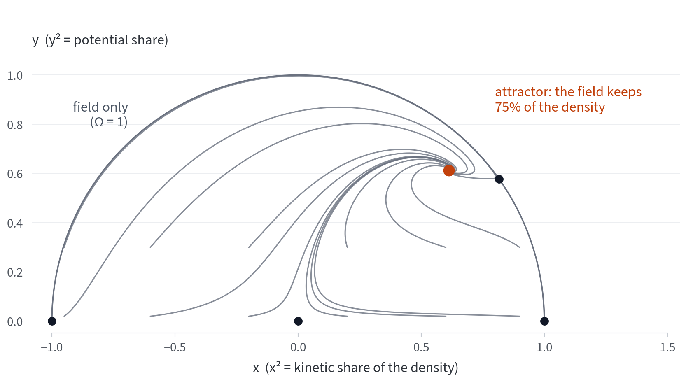

Dark energy need not be a constant. For a scalar field with an exponential potential (slope λ = 2) in a universe that also holds matter, twelve different starting states all flow to the same point: the field ends up holding 75% of the density whatever it started with (the trajectories end within 2 × 10⁻¹² of the fixed point). The fixed points and their stability are computed from the table of Copeland, Sami & Tsujikawa (2006). Record: [quintessence.json](figures/quintessence.json).

### Stars and gas

<p>
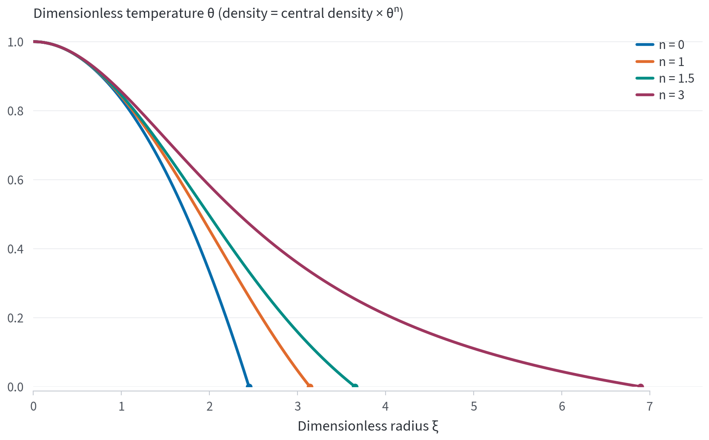
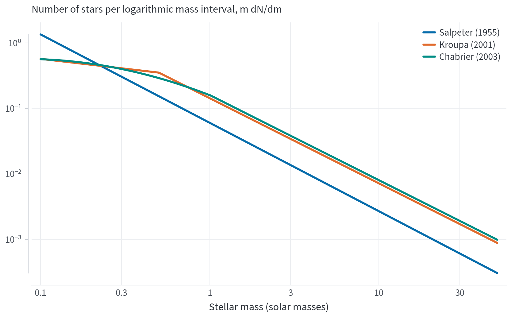
</p>

On the left, polytropic stellar models: the larger the index, the more the star is concentrated at the center (for n = 3 the central density is 54 times the mean). On the right, three initial mass functions, normalized to the same total number over the range 0.1-50 solar masses: above 1 solar mass their slopes are the same; below it Salpeter predicts many more small stars.

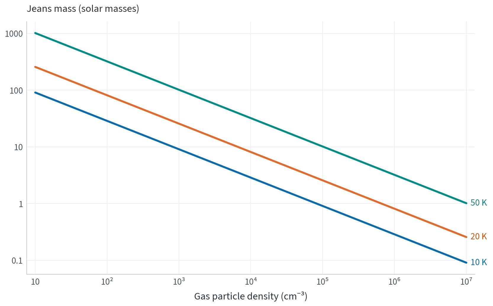

The smallest mass a gas cloud needs to collapse under its own gravity. At a temperature of 10 K and a particle density of 10⁴ per cubic centimeter it is about 3 solar masses.

## From real observations

The same rule covers the observing side: archive access, FITS files, image reduction, photometry and astrometry, each tested on real data.

### Star catalog: the Sun's neighborhood with Gaia

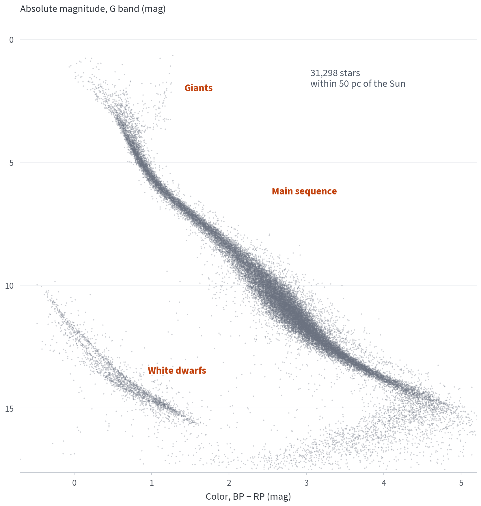

The 31,298 stars within 50 parsecs of the Sun gather on the main sequence, the white dwarf sequence and the giant branch. The catalog is downloaded from Gaia DR3 with a TAP client we wrote ourselves (parallax signal-to-noise ratio > 20, RUWE < 1.4). Gaia saturates on very bright stars, so the brightest stars are missing from the sample.

### The same field, three wavelengths: optical and infrared

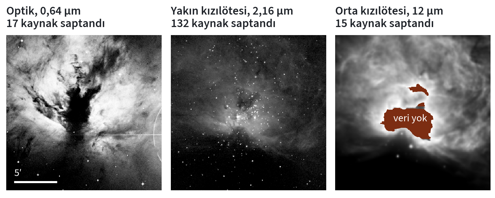

In the Flame Nebula (NGC 2024), dust hides the stars in visible light; at 2 µm the number of sources detected in the same field rises from 17 to 132. At 12 µm the emission of the heated dust itself is visible; in the brick-colored region in the middle, 10,247 pixels carry no data (NaN in the FITS file). The WISE Explanatory Supplement (section I.4.c.vii) gives the reason: saturated pixels are masked in single exposures and do not enter the Atlas image; bright regions above the saturation limit become NaN, and these gaps are typically seen at the peak of the emission. The gap here is also in the middle of the brightest emission. The images are downloaded from NASA SkyView and read with our own FITS reader; the background map and source detection are done with `kozmos.photometry`.


A color-preserving composite of the same field from the 2MASS J, H and K bands (Lupton et al. 2004 stretch). The red stars inside the dust lane are much brighter in the K band than in the J band; this is consistent with the reddening of light that comes through the dust.

### Validation on a real image: against the 2MASS catalog


Source detection, the WCS transform and catalog matching were tested against the 2MASS Point Source Catalog on the 2MASS K image of the same field (1 arcsec/pixel) ([real_image_validation.py](examples/real_image_validation.py), record: [real_image_validation.json](figures/real_image_validation.json)):

- Of the 61 catalog stars in the range K = 7-11, 59 were found; of the artificial stars added to the image, at least 94% were recovered for K ≤ 12 and 51% at K = 14.
- 85% of the 281 detected sources have a catalog counterpart within 2 arcseconds; some of the rest are bright knots of the nebula.
- The median position difference is 0.16 arcsec in right ascension and 0.03 arcsec in declination; the scatter is 0.14 and 0.13 arcsec on the two axes. The residuals gather in two clumps; the cause was not investigated (resampling by SkyView is likely).
- The scatter of the zero point between the aperture magnitude and the catalog K magnitude is 0.021 mag over 40 isolated stars.

The step that separates overlapping sources was added during this test: without deblending, 84% of the bright artificial stars were found. On the same image, the WCS in the header was deliberately corrupted (0.4° rotation, 0.4% scale, shifts of 18 and 14 pixels) and re-solved from the catalog using only the detected sources: the largest position error fell from 25.8 arcsec to 0.43 arcsec (246 stars). Because the catalog was produced from the data of the same survey, this test measures the code, not 2MASS itself. A blind solution by triangle matching, with no use of the header at all, reached the same result: 24 pairs were assigned, the solution with 246 stars differed from the header WCS by at most 0.43 arcsec; the scale found was 0.9998 arcsec/pixel (1 in the header).

### Reduction with real raw data

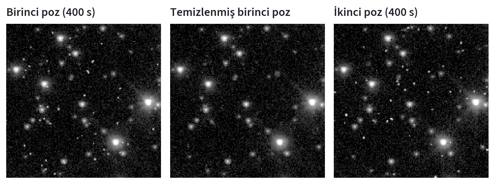

Cosmic-ray cleaning was tested on two Hubble STIS observations; each file holds two consecutive exposures with the same orientation. Because cosmic rays fall on different pixels in the two exposures, the difference of the exposures gives an independent criterion ([cosmic_rays_real_data.py](examples/cosmic_rays_real_data.py)):

| Field | Pixels above 6σ in the difference | Found | Found above 20σ | Purity | Deviation before and after cleaning |
|---|---|---|---|---|---|
| M5 globular cluster (crowded with stars) | 7081 | 77% | 97% | 91% | 29σ, 1.0σ |
| Abell 1795 galaxy cluster (sparse, diffuse sources) | 14059 | 84% | 98% | 97% | 39σ, 0.8σ |

Purity is the fraction of flagged pixels that are adjacent to a real cosmic ray. The step that applies a low threshold to the neighbors of flagged pixels was added during this test; without it, completeness was 60% and 66%. The f_lim = 5 that the source paper recommends for undersampled data gave lower completeness than f_lim = 2 in these two fields (64% and 72%).

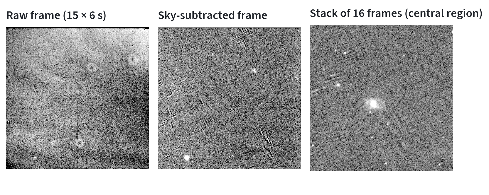

The infrared reduction was run end to end on two raw Ks sequences from ESO NTT/SOFI, with the dome flat of the same night ([infrared_reduction.py](examples/infrared_reduction.py)):

<details>
<summary>Numbers of the infrared reduction: two fields, astrometry, zero points</summary>

| | SN 2011bm field (sparse) | SN 2005at field (rich, the galaxy fills the field) |
|---|---|---|
| Number of frames and duration | 16 frames, 28 minutes | 32 frames, 53 minutes |
| Large-scale residual (ADU) | 156 → 0.8 | 159 → 4.6 |
| Pixel noise (ADU) | 251 → 7.2 | 260 → 9.9 |
| Offset vs. header command difference (pixels) | 0.7 | 3.1 |
| 2MASS stars in the field, detected | 5, 5 | 48, 33 |
| Astrometry residual (arcsec) | 0.45 | 0.47 |
| Zero point (point sources) | 1 star: 24.02 | 10 stars: 24.23, scatter 0.065 mag |
| Blind solution, with the 2MASS catalog | rejected (few common stars) | same as the solution started from the header |
| Astrometry with Gaia DR3 | 10 stars, 0.17″ residual | 123 stars, 0.29″ residual |
| Blind solution, with Gaia DR3 | 8 stars, 0.16″; at most 0.81″ from the solution started from the header | 122 stars; at most 0.004″ from the solution started from the header |

In the rich field, the zero-point scatter (0.065 mag) is below the median catalog uncertainty of the 2MASS stars used (0.10 mag). Only point sources enter the zero point: the 2MASS Point Source Catalog also contains compact galaxies, and a fixed aperture underestimates their flux; in the rich field, 4 of 14 candidates were rejected for this reason (the scatter without the filter was 0.094 mag).

The flat field was built with the dome flat recipe of the SOFI User Manual (section 5.2.5: shading correction with masked frames). The flux scatter of the same star across frames is 3.1% without a flat, 2.7% with a simple flat, and 2.9% with the special flat (15 stars; 1.8% expected from background noise alone). By this measure the special flat did not do better than the simple flat; the ratio of the two differs by only 0.3% between the two halves of the sequence. In these sequences the static sky model gave less noise than the dynamic model. When the galaxy fills the field, the large-scale residual stays higher (4.5 ADU): an object larger than the dither step leaks into the model.

In the sparse field, 2MASS is not enough: the fully covered region holds only 5 catalog stars. The astrometry was set up with Gaia DR3 (positions were moved to the epoch of observation with proper motion); the blind solution also succeeded with Gaia, while with 2MASS it produced a wrong solution that was rejected in the verification step. In photometry there were two candidates, and their zero points were 0.77 mag apart. The deviant candidate is not a point source: the flux ratio of its narrow aperture to its wide aperture is 0.27, against a median of 0.78 for the Gaia stars in the field; that is, it is a galaxy, and the aperture misses most of its flux. Because a calibration cannot be made with the single remaining star, the standard star sequences of the same nights were also downloaded from the archive and reduced (fields FS14 and FS24; the calibrators are the 2MASS stars in the frames). The four independent zero points, reduced to per second and to a 10-pixel aperture:

| Field | Night | Airmass | Stars | Zero point (mag) |
|---|---|---|---|---|
| FS14 standard field | 13/14 March | 1.19 | 17 | 22.16 (scatter 0.051) |
| SN 2005at | 13/14 March | 1.45 | 10 | 22.18 |
| FS24 standard field | 14/15 March | 1.44 | 2 | 22.10 |
| SN 2011bm (sparse field) | 14/15 March | 1.70 | 1 | 22.13 |

The four values fit in a range of 0.08 mag. The single star of the sparse field differs by 0.04 mag from the standard field of the same night and by 0.03 mag from the 17-star standard field of the other night; the catalog uncertainty of the star is 0.06 mag. The rule that the per-second reduction rests on was read from the manual: the counts in the raw file correspond to a single DIT (NDIT is the mean of the sub-exposures). Extinction was measured within the sequence: in the SN 2005at sequence, the relative magnitude of 15 bright stars changes with airmass (1.33-1.45) with a slope of 0.10 ± 0.04 mag/airmass (32 frames, residual 0.008 mag per frame). This slope cannot separate extinction from a drift in transparency, and the range is narrow. When the four zero points are reduced to airmass 1 with this slope, the range changes from 0.08 mag to 0.09 mag; that is, the correction does not improve the agreement of the values. The slope could not be measured in the sparse sequence (a single star of sufficient brightness). The zero point recommended for the sparse field is therefore not its own single star but the common level of the four values; the FS24 field has only 2 calibrator stars; when the threshold on the 2MASS uncertainty is relaxed to 0.10 mag the number rises to 7, but the scatter grows to 0.15 mag and the value drops by 0.11 mag (faint stars are noisy in the 6-second total exposure), so the strict selection was kept. In the ESO archive, no Ks standard sequence other than these two exists in the two weeks around the observation epoch.

Of the reduction steps in the manual, the cross talk correction and the illumination correction were not applied. Cross-hatched residual patterns remain in a single sky-subtracted frame; the cause was not investigated.

</details>

### Bright stars: sky map

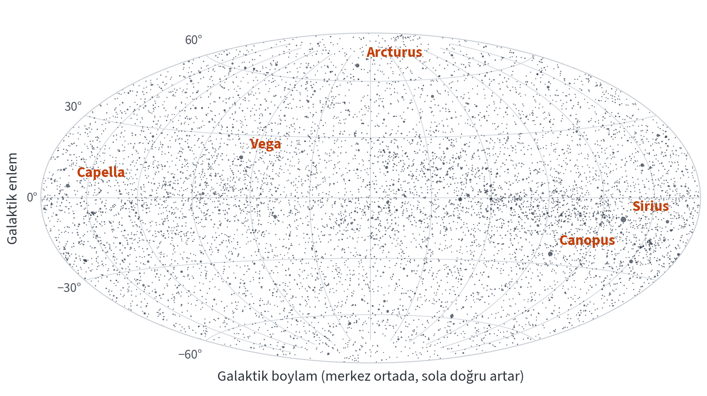

The 9096 stars of the Bright Star Catalogue (5th edition) that carry a position and a magnitude, in galactic coordinates. 47% of the stars lie in the band of ±20° of galactic latitude; for a uniform distribution this fraction would be 34%. The naked-eye stars on which Gaia saturates come from this catalog.

## What is included

**Observing and data**

- `archives`: TAP client, Gaia DR3 star samples and cone search (epoch transfer with proper motion), 2MASS point source cone search, Bright Star Catalogue, SkyView image cutouts (DSS2, 2MASS, WISE), Pantheon+ data; every download is recorded with a SHA-256 digest, and transient network errors are retried
- `io`: FITS reader and writer (from the FITS 4.0 standard); primary unit, image extensions, binary table extensions (all column types, variable-length arrays, scaling and nulls) and ESO HIERARCH header cards
- `observing`: target visibility and airmass (with precession and atmospheric refraction), CCD signal model, synthetic raw frame, signal-to-noise ratio
- `reduction`: frame combining with sigma clipping, bias/dark/flat-field correction, gain and read-noise measurement, single-frame cosmic-ray cleaning (L.A.Cosmic), sky subtraction from dithered infrared frames
- `photometry`: background map, source detection and deblending of overlapping sources, aperture photometry, PSF-fitting photometry (Gaussian and Moffat profiles, simultaneous fits of blended groups)
- `astrometry`: FITS WCS pixel-to-sky transform (TAN projection with SIP distortion polynomials, reading and fitting), catalog cross-matching, astrometric solution from an approximate WCS (with outlier rejection) and without an initial WCS (triangle matching)
- `spectroscopy`: air and vacuum wavelengths, equivalent widths and line fits (Gaussian, Voigt), box and optimal (Horne) extraction, radial velocities by cross-correlation (Tonry & Davis)
- `visualization`: asinh stretch and color-preserving RGB composite
- `radiation`: magnitude systems, Planck function, 2MASS and WISE zero points
- `timeseries`: Lomb-Scargle periodogram

**Astrophysics**

- `black_holes`: Schwarzschild and Kerr radii, shadow size, accretion (Eddington, Bondi, thin disk), Hawking radiation, gravitational-wave frequency of merging binaries; Kerr circular orbits at any radius (energy, angular momentum, angular velocity), epicyclic and precession frequencies, frame dragging, horizon area, irreducible mass, surface gravity, temperature and entropy of a rotating hole, the area theorem for mergers
- `relativity`: special relativity (boosts, velocity addition, Doppler shift and aberration, four-momentum); metrics (Minkowski, Schwarzschild, Reissner-Nordström, Kerr, FLRW, two horizon-penetrating forms); Christoffel symbols and geodesic integration for any metric given as a function, Killing constants and a Killing-equation check; Riemann, Ricci and Einstein tensors and the Kretschmann scalar; perihelion advance, light deflection, Shapiro delay, geodetic precession
- `stars`: Lane-Emden polytropes, stellar scaling relations, Chandrasekhar mass, initial mass functions
- `star_formation`: Jeans and Bonnor-Ebert masses, free-fall time, virial parameter, Kennicutt-Schmidt law, Toomre Q
- `cosmology`: distance measures for w0-wa dark energy with curvature and radiation, Hubble diagram likelihood; equation of state, density parameters, deceleration parameter, onset of acceleration, age, big-rip time; linear growth factor, growth rate and growth index; quintessence (the autonomous system of the exponential potential with its fixed points, and a scalar field with any potential)
- `ephemeris`: Kepler's equation and orbit relations

**Foundations**

- `mechanics`: for a Lagrangian given as a Python function: momenta, the Euler-Lagrange equations and their integration, the energy function, the action of a path; the Legendre transform to a Hamiltonian, Hamilton's equations and Poisson brackets; Noether charges, with a number that says by how much a transformation fails to be a symmetry (translations, rotations, boosts, time translation and scale transformations are built in); leapfrog and fourth-order symplectic integrators; kinetic, potential and total energy, momentum, angular momentum and virial ratio of a particle system

**Infrastructure**

- `core`: CODATA 2022 constants, IAU nominal values, angle arithmetic, quantities with dimension checking (`core.units`: `with_units` reads the unit from the suffix of each argument name, converts quantities given in other units and rejects a wrong dimension)
- `time`, `coordinates`: Julian date, leap seconds, sidereal time, galactic and horizontal transforms, IAU 2006 precession
- `statistics`: linear fitting, MCMC with a convergence-driven stopping rule, convergence diagnostics, robust estimators

## How the source rule works

```python
@source("Hogg1999", where="Eq. 15", status="read")
def comoving_distance_mpc(z, cosmology):
    """Compute the line-of-sight comoving distance.

    References
    ----------
    [Hogg1999] Eq. 15.

    Verification
    ------------
    tests/oracle/test_cosmology_oracle.py
    """
```

- `status="read"`: the equation was taken from the text of the source while the code was written (arXiv TeX file, standard document, source code).
- `status="pending"`: the equation was written in its known form and tested, but the text of the source has not yet been opened.

For every public function, a test checks that the record exists, that the key is defined in the [bibliography](bibliography/), that the docstring cites the same source, and that the test file it points to exists. The entries in the bibliography are also tested: [bibliography/verify.py](bibliography/verify.py) queries every DOI at Crossref and every arXiv identifier at arXiv.

Opening the text of a source changed results. Four of the things found while reading:

- The Kerr photon orbit formula in a review article, as printed, gives the retrograde orbit, not the prograde one.
- The two common definitions of the Jeans mass differ by a factor of 4π/3; the function offers both by name.
- The mass coefficient column of the polytrope table in one source agrees with the standard definition only for n = 3.
- A set of lecture notes prints the curvature invariant of the Schwarzschild metric as 12 G²M²/r⁶; the value is 48 G²M²/r⁶, which the curvature module computes from the metric and a second source confirms.

The details are in [plan/04_physics/08_black_holes_stars_and_star_formation.md](plan/04_physics/08_black_holes_stars_and_star_formation.md).

## Installation and usage

Python 3.12 or later is required.

```
pip install -e ".[verification,dev,plotting]"
pytest -m "not network"
```

To reproduce the figures (the scripts download the data themselves):

```
python projects/hubble/hubble_analysis.py     # about 30 minutes; runs until the chain has converged
python projects/hubble/hubble_figure.py
python examples/hr_diagram.py
python examples/optical_infrared.py
python examples/physics_gallery.py
python examples/relativity_gallery.py      # banner, orbits, energy conservation, quintessence, dark energy; about 3 minutes
python projects/dark_energy/wcdm_analysis.py   # about 3 minutes
python examples/sky_map.py
python examples/real_image_validation.py
python examples/cosmic_rays_real_data.py
python examples/infrared_reduction.py      # the SOFI frames must be downloaded and unpacked first: examples/eso_sofi_frames.txt
python projects/hubble/h0_uncertainty_check.py
```

The figures in the repository were produced with a local figure-audit tool (`datawiz`); the tool is not in this repository. If the tool is not installed, the scripts draw the same data with plain matplotlib ([examples/_plotting.py](examples/_plotting.py)); the appearance then differs from the figures in the repository.

## Limits

- The newly written physics modules were tested with their own tests, closed-form solutions and the numbers in the sources. A comparison with an independent library exists in the time, coordinates, cosmology, statistics, FITS and periodogram modules.
- Observation planning includes frame bias, precession and optional refraction; it has no nutation, aberration or UT1 − UTC difference. On 30 random targets the largest direction difference from astropy is 0.45 arcmin (26 arcmin in the calculation without precession). The refraction model is invalid below an altitude of about 5°.
- The FITS reader reads the primary unit, image extensions and binary tables. ASCII tables are not read and tile-compressed images are not decompressed. The binary-table reader was tested against astropy on written files and against hand-made files; no archive file with a binary table was at hand, so it has not been run on one.
- Source deblending separates pairs with a clear saddle between them: at a separation of 2 FWHM, 92-98% of the pairs with a flux ratio up to 2 are separated, and 14% at a ratio of 3 with the default setting. Aperture photometry underestimates by a few percent in narrow apertures.
- The WCS covers only the TAN projection, with optional SIP polynomials (agreement with astropy 5e-14 degrees; `fit_sip` holds the linear terms fixed and was tested on synthetic stars only). `fit_wcs` and `refine_wcs` return a linear solution and drop any SIP terms of the input. The blind astrometric solution works without knowing the scale, orientation or mirror image, but it asks for the catalog of the region the image covers (approximate sky position and field width); it is not an indexed solver that searches the whole sky, and it rejects the solution if it cannot find at least 8 common stars.
- The tests on real raw data rest on two STIS observations and two SOFI sequences; all are a single instrument and a single filter. The SOFI frames download as `.fits.Z` and our reader does not decompress them (`gzip -d` is needed). A separate dark is not subtracted (the sky model also contains the dark); the flat field is the special dome flat of the manual.
- Cosmic-ray cleaning against Astro-SCRAPPY 1.3.0 on the two STIS frames, same parameters and same truth ([figures/cosmic_rays_real_data.json](figures/cosmic_rays_real_data.json)): ours finds 77% and 84% of the true pixels, Astro-SCRAPPY 95% and 97% (both 97-98% above 20σ); ours takes 10-15 s per 1024 × 1024 frame, Astro-SCRAPPY 1-3 s. In the crowded M5 field ours flags 545 pixels that show no excess between the two exposures, Astro-SCRAPPY about 22,000; in the sparse field 353 against 1,424.
- PSF photometry uses analytic profiles only: on a real 2MASS image the Gaussian recovers the 1-FWHM aperture flux to 0.6% but the reduced χ² is 9, because the real PSF has wider wings. There is no empirical PSF and no comparison with another PSF-fitting code.
- The spectroscopy functions were tested on synthetic spectra and on the numbers printed in their sources, not on observed spectra. The cross-correlation error estimate of Tonry & Davis holds at a signal-to-noise ratio of about 20-50 and is 2-3 times too small above 100.
- Unit checking is opt-in (`with_units`); the library functions themselves still take plain numbers in the unit named by the suffix.
- The mechanics and relativity packages differentiate the user's function numerically. The default complex-step derivative is exact to rounding whatever the units, but needs a function that accepts complex numbers; one that does not (`abs`, `norm`, comparisons) is detected and refused. Second derivatives and `method="finite"` use finite differences that carry an error estimate and search the step over twenty-one decades; a result that the estimate does not support is refused (`DerivativePrecisionError`, `CurvaturePrecisionError`) rather than returned. Measured in SI units: a planet at 7.8e11 m 1e-16, an electron in a Coulomb field 1e-13, the curvature of a 1e9 solar mass black hole in metres 2e-13 at 4 M and 3e-10 at 1e4 M. Not detected: a non-analytic part whose derivative is below 2e-11 of the function value per unit of its argument, and structure a hundred times finer than the first step with an amplitude below 1e-10 of the function value. A curvature more than about twelve orders of magnitude below the connection terms is returned as zero with a warning. Lagrangians with a singular mass matrix (constraints) are not handled. The cost grows with the square of the number of coordinates (measured for two coordinates inside an integration: about 66 evaluations of the Lagrangian per acceleration with the complex step, about 860 with `method="finite"`), so the Lagrangian integrator is for a few degrees of freedom; N-body runs use the symplectic integrators. How these limits were found: [plan/AUDIT_2026-11-26.md](plan/AUDIT_2026-11-26.md).
- The advanced modules are tied to the foundations in [tests/unit/test_foundations_cross_check.py](tests/unit/test_foundations_cross_check.py): the geodesic equation equals the Euler-Lagrange equation of ½ g u u for the Kerr metric (1.9e-11), Killing constants equal Noether charges, the Kerr circular-orbit formulas satisfy the geodesic equation (residual 3e-17), the Klein-Gordon equation follows from the scalar-field Lagrangian, and a null geodesic of the FLRW metric reproduces the cosmological redshift (2e-12).
- Relativity: the geodesic integrator has no stopping condition at a horizon, and curvature loses accuracy far from the source (Ricci residual 1e-7 of the curvature scale at 30 gravitational radii). There is no Lense-Thirring precession formula, no ray tracing of images, and nothing beyond test particles (no perturbation theory, no numerical relativity). The angular momentum of Kerr circular orbits follows a printed closed form (Pugliese, Quevedo & Ruffini 2011); the energy is derived in this project from it and from the metric, and agrees with the energy printed in the same paper to 1.4e-14 on a grid of radii and spins. The epicyclic frequencies agree with the oscillations of an integrated, slightly perturbed geodesic to 4e-9 (radial) and 7e-6 (vertical); the precession frequencies are differences of the printed frequencies.
- Dark energy: growth assumes smooth dark energy and matter-dominated initial conditions (error 1e-6 when radiation is included). The growth-index approximation reproduces the growth factor to the accuracy Linder states (0.05% for ΛCDM) but the growth rate only to 0.6-1.1%. The big-rip formula of the source holds for a universe of dark energy alone and is 14% short for Ωm = 0.3, w = −1.5. Against astropy, distances agree to 8e-12 up to z = 10 and to 3e-12 at z = 1100 with radiation.
- SkyView cutouts are resampled images; photometric calibration needs the original archive data.

## Plan

The [plan/](plan/00_README.md) folder holds the design of the project: field survey, mathematics, physics, data science, architecture, roadmap and function inventory. The equations in the plan documents are at planning level; when a function is written, the equation is taken from its source.

## License

Copyright © 2026 Ayberk. All rights reserved; see the [LICENSE](LICENSE) file for details. The notice for the ERFA algorithms that some functions follow is in [THIRD_PARTY_NOTICES.md](THIRD_PARTY_NOTICES.md). The data used by the analyses is not put in the repository; it is downloaded from its source at run time. Some of the figures are derived from DSS2, 2MASS, WISE, Gaia, Bright Star Catalogue, Pantheon+, Hubble STIS and ESO SOFI data; the reservation of rights does not cover these figures. `optical_infrared.png`, which contains DSS data, is shared under CC BY-NC-SA 4.0, and Gaia data is licensed under CC BY-NC 3.0 IGO. The terms of each survey and the requested acknowledgement texts are in the same notice file.

This publication makes use of data products from the Two Micron All Sky Survey, which is a joint project of the University of Massachusetts and the Infrared Processing and Analysis Center/California Institute of Technology, funded by the National Aeronautics and Space Administration and the National Science Foundation. This publication makes use of data products from the Wide-field Infrared Survey Explorer, which is a joint project of the University of California, Los Angeles, and the Jet Propulsion Laboratory/California Institute of Technology, funded by the National Aeronautics and Space Administration. This research has made use of the NASA/IPAC Infrared Science Archive, which is funded by the National Aeronautics and Space Administration and operated by the California Institute of Technology. This research is based on observations made with the NASA/ESA Hubble Space Telescope obtained from the Space Telescope Science Institute, which is operated by the Association of Universities for Research in Astronomy, Inc., under NASA contract NAS5-26555. These observations are associated with programs 8310 and 7245. Based on observations collected at the European Southern Observatory under ESO programme 184.D-1152(F).
