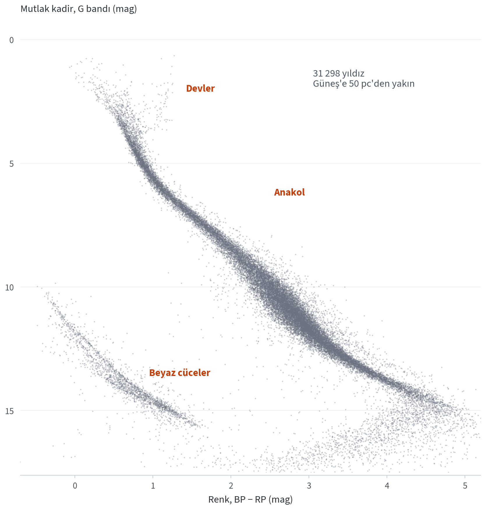
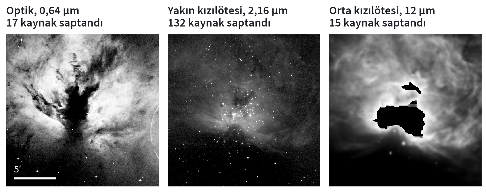
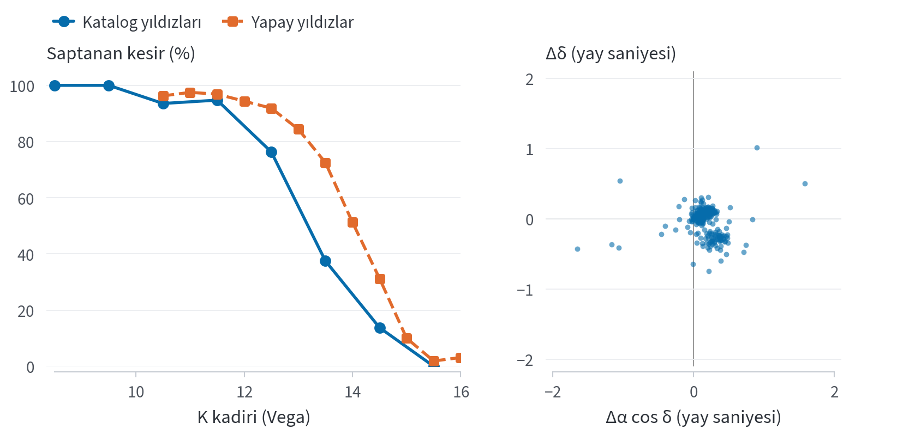
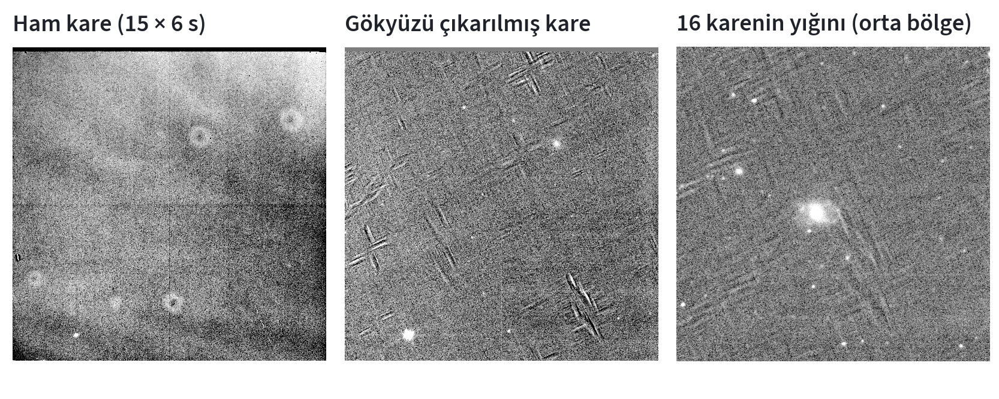
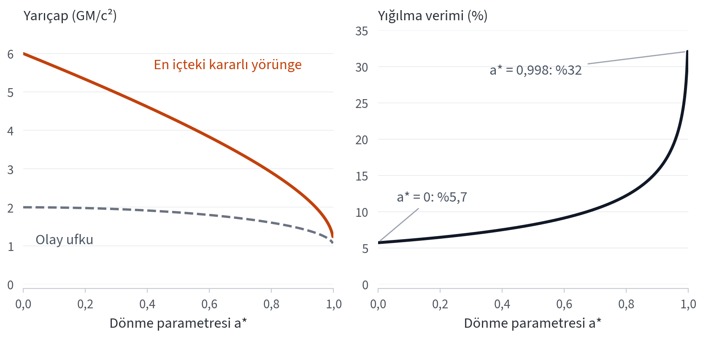
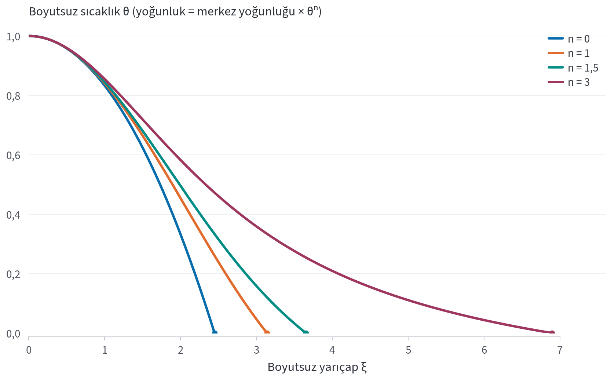
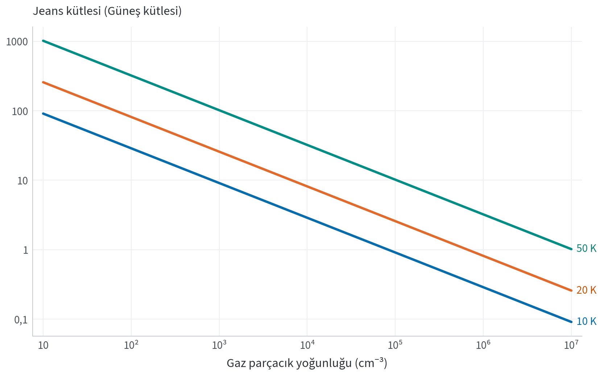

# astrostuff

`kozmos`: gökbilim ve astrofizik hesapları için sıfırdan yazılan bir Python kitaplığı. Tek bir kuralı var:

> **Her fonksiyon, uyguladığı denklemin yayımlanmış kaynağını gösterir ve bağımsız bir hesaba karşı sınanır. Kaynağı olmayan fonksiyon testten geçemez.**

Kitaplık çalışırken yalnızca NumPy ve SciPy kullanır. Astropy ve ERFA hesap için değil, sonuçları karşılaştırmak için vardır.

- 230 fonksiyon, 35 sabit, 1095 test
- 270 kaynak kaydının hepsinde denklem kaynağın metninden okundu; "bekliyor" işaretli kayıt kalmadı
- Güncel sayılar: [plan/DURUM.md](plan/DURUM.md) (koddan üretilir)

## Kitaplıkla üretilen sonuçlar

Aşağıdaki şekillerin hepsi bu depodaki kodla, açık veriden ya da doğrudan fonksiyon çıktısından üretilmiştir. Üreten betikler [ornekler/](ornekler/) ve [projeler/](projeler/) klasörlerindedir.

### Hubble sabiti: Pantheon+ süpernovaları


Kod açık [Pantheon+SH0ES verisini](https://github.com/PantheonPlusSH0ES/DataRelease) indirir, 1701 × 1701 kovaryans matrisiyle olabilirliği kurar ve kendi yazdığımız MCMC örnekleyicisiyle parametreleri kestirir. Bulunan değerler yayımlananları yeniden üretir:

- Madde yoğunluğu: **Ωm = 0,332 ± 0,018** (yayımlanan 0,334 ± 0,018)
- Hubble sabiti: **H0 = 73,53 ± 1,00 km s⁻¹ Mpc⁻¹** (yayımlanan 73,6 ± 1,1)

Yayımlanan değerler Brout ve ark. (2022) makalesinin arXiv kaynağından okundu. Kayıt: [projeler/hubble/sonuc.json](projeler/hubble/sonuc.json).

Bulunan H0 belirsizliği yayımlanandan küçüktür. Üç bağımsız denetim bizim değeri destekliyor ([h0_belirsizlik_denetimi.py](projeler/hubble/h0_belirsizlik_denetimi.py)):

- Zincirden bağımsız kapalı biçimli çözüm aynı veriden 73,52 ± 1,02 verir; kırmızıya kayma kesimi hiç uygulanmazsa 73,41 ± 1,01, kesim 0,023'e çıkarılırsa 73,70 ± 1,03; veri sürümündeki olabilirlik kodunun uzaklık tanımıyla (d_L = (1 + z_HEL) D_M) 73,53 ± 1,02.
- Veri sürümündeki dört zincirin (emcee) hepsi, ilk %10'u atılınca ± 1,01 ile ± 1,04 arasında saçılım verir; baş kısım atılmazsa ± 1,03 ile ± 1,07 arasındadır. Düz ΛCDM zinciri 73,53 ± 1,01'dir.
- Riess ve ark. (2022) temel sonucu ± 1,01'dir; aynı makalenin özeti, yüksek kırmızıya kaymalı süpernovalar eklendiğinde 73,30 ± 1,04 verir.

Makale dört model için de ± 1,1 yazar; yayımlanan zincirlerin hiçbiri bu değeri vermez (tek ondalıkla hepsi ± 1,0'a yuvarlanır). Makale örnekleyici olarak PolyChord'u anar, veri sürümündeki zincirler emcee'dir; PolyChord zincirleri yayımlanmadı. Yayımlanan veri ve yayımlanan olabilirlik kodu, zincirle de zincirsiz de ± 1,0 verir; ± 1,1'in kaynağı açık veriden bulunamadı.

### Yıldız kataloğu: Gaia ile Güneş çevresi



Güneş'e 50 parsekten yakın 31 298 yıldız anakol, beyaz cüce dizisi ve dev kolunda toplanıyor. Katalog Gaia DR3'ten kendi yazdığımız TAP istemcisiyle indirilir (paralaks sinyal-gürültü oranı > 20, RUWE < 1,4). Gaia çok parlak yıldızlarda doyduğu için en parlak yıldızlar örneklemde yoktur.

### Aynı alan, üç dalga boyu: optik ve kızılötesi



Alev Bulutsusu'nda (NGC 2024) toz, görünür ışıkta yıldızları gizler; 2 µm'de aynı alanda saptanan kaynak sayısı 17'den 132'ye çıkar. 12 µm'de ısınmış tozun kendi ışıması görünür; ortadaki kiremit rengi bölgede 10 247 piksel veri taşımaz (FITS dosyasında NaN). WISE Açıklayıcı Eki (bölüm I.4.c.vii) nedeni verir: doymuş pikseller tek pozlarda maskelenir ve Atlas görüntüsüne girmez; doyma sınırını aşan parlak bölgeler NaN olur ve bu boşluklar tipik olarak ışımanın tepesinde görülür. Buradaki boşluk da en parlak ışımanın ortasındadır. Görüntüler NASA SkyView'dan indirilir, kendi FITS okuyucumuzla okunur; arka plan haritası ve kaynak saptama `kozmos.fotometri` ile yapılır.


Aynı alanın 2MASS J, H ve K bantlarından renk koruyan bileşimi (Lupton ve ark. 2004 germesi). Toz şeridinin içindeki kırmızı yıldızlar K bandında J bandına göre çok daha parlaktır; bu, tozun içinden gelen ışığın kızarmasıyla uyumludur.

### Gerçek görüntüde doğrulama: 2MASS kataloğuna karşı



Kaynak saptama, WCS dönüşümü ve katalog eşleme aynı alanın 2MASS K görüntüsünde (1 yay saniyesi/piksel) 2MASS Nokta Kaynak Kataloğu'na karşı sınandı ([gercek_goruntu_dogrulamasi.py](ornekler/gercek_goruntu_dogrulamasi.py), kayıt: [gercek_goruntu_dogrulamasi.json](belgeler/gercek_goruntu_dogrulamasi.json)):

- K = 7-11 aralığındaki 61 katalog yıldızının 59'u bulundu; görüntüye eklenen yapay yıldızların K ≤ 12 için en az %94'ü, K = 14'te %51'i geri bulundu.
- Saptanan 281 kaynağın %85'inin 2 yay saniyesi içinde katalog karşılığı var; kalanların bir kısmı bulutsunun parlak düğümleridir.
- Konum farkının ortancası sağ açıklıkta 0,16, dik açıklıkta 0,03 yay saniyesi; saçılım iki eksende 0,14 ve 0,13 yay saniyesi. Artıklar iki öbekte toplanıyor; nedeni incelenmedi (SkyView'ın yeniden örneklemesi olası).
- Açıklık kadiri ile katalog K kadiri arasındaki sıfır noktasının saçılımı 40 yalıtılmış yıldızda 0,021 kadir.

Örtüşen kaynakları ayıran adım bu sınamada eklendi: ayrıştırma olmadan parlak yapay yıldızların %84'ü bulunuyordu. Aynı görüntüde başlıktaki WCS bilerek bozulup (0,4° dönme, %0,4 ölçek, 18 ve 14 piksel kaydırma) yalnızca saptanan kaynaklarla katalogdan yeniden çözüldü: en büyük konum hatası 25,8 yay saniyesinden 0,43 yay saniyesine indi (246 yıldız). Katalog aynı taramanın verisinden üretildiği için bu sınama kodu ölçer, 2MASS'in kendisini değil. Başlık hiç kullanılmadan, üçgen eşlemeyle yapılan kör çözüm de aynı sonuca vardı: 24 çift atandı, 246 yıldızla çözüm başlıktaki WCS'ten en çok 0,43 yay saniyesi ayrıldı; bulunan ölçek 0,9998 yay saniyesi/piksel (başlıkta 1).

### Gerçek ham veriyle indirgeme


Kozmik ışın temizliği iki Hubble STIS gözleminde sınandı; her dosya aynı yönelimde iki ardışık poz taşır. Kozmik ışınlar iki pozda farklı piksellere düştüğü için pozların farkı bağımsız bir ölçüt verir ([kozmik_isin_gercek_veri.py](ornekler/kozmik_isin_gercek_veri.py)):

| Alan | Farkta 6σ üstü piksel | Bulunan | 20σ üstünde bulunan | Saflık | Temizlik öncesi ve sonrası sapma |
|---|---|---|---|---|---|
| M5 küresel kümesi (yıldızca kalabalık) | 7081 | %77 | %97 | %91 | 29σ, 1,0σ |
| Abell 1795 gökada kümesi (seyrek, yaygın kaynaklı) | 14059 | %84 | %98 | %97 | 39σ, 0,8σ |

Saflık, işaretlenen piksellerin gerçek bir kozmik ışına bitişik olan kesridir. İşaretlenen piksellerin komşularına düşük eşik uygulayan adım bu sınamada eklendi; onsuz tamlık %60 ve %66 idi. Kaynak makalenin eksik örneklenmiş veri için önerdiği f_lim = 5, bu iki alanda f_lim = 2'den düşük tamlık verdi (%64 ve %72).



Kızılötesi indirgeme ESO NTT/SOFI'nin iki ham Ks dizisinde, aynı gecenin kubbe düz alanıyla uçtan uca koşuldu ([kizilotesi_indirgeme.py](ornekler/kizilotesi_indirgeme.py)):

| | SN 2011bm alanı (seyrek) | SN 2005at alanı (zengin, gökada alanı doldurur) |
|---|---|---|
| Kare sayısı ve süre | 16 kare, 28 dakika | 32 kare, 53 dakika |
| Büyük ölçekli artık (ADU) | 156 → 0,8 | 159 → 4,6 |
| Piksel gürültüsü (ADU) | 251 → 7,2 | 260 → 9,9 |
| Öteleme ile başlık komutu farkı (piksel) | 0,7 | 3,1 |
| Alandaki 2MASS yıldızı, saptanan | 5, 5 | 48, 33 |
| Astrometri artığı (yay saniyesi) | 0,45 | 0,47 |
| Sıfır noktası (nokta kaynaklar) | 1 yıldız: 24,02 | 10 yıldız: 24,23, saçılım 0,065 kadir |
| Kör çözüm, 2MASS kataloğuyla | reddedildi (ortak yıldız az) | başlıktan başlayan çözümle aynı |
| Gaia DR3 ile astrometri | 10 yıldız, 0,17″ artık | 123 yıldız, 0,29″ artık |
| Kör çözüm, Gaia DR3 ile | 8 yıldız, 0,16″; başlıktan başlayan çözümden en çok 0,81″ | 122 yıldız; başlıktan başlayan çözümden en çok 0,004″ |

Zengin alanda sıfır noktası saçılımı (0,065 kadir) kullanılan 2MASS yıldızlarının ortanca katalog belirsizliğinin (0,10 kadir) altındadır. Sıfır noktasına yalnızca nokta kaynaklar girer: 2MASS Nokta Kaynak Kataloğu sıkı gökadaları da içerir ve sabit açıklık bunların akısını eksik ölçer; zengin alanda 14 adaydan 4'ü bu yüzden atıldı (süzgeçsiz saçılım 0,094 kadirdi).

Düz alan SOFI Kullanım Kılavuzu'nun özel kubbe düz alanı tarifiyle kuruldu (Bölüm 5.2.5: maskeli karelerle gölgelenme düzeltmesi). Aynı yıldızın karelerdeki akı saçılımı düz alansız %3,1, basit düz alanla %2,7, özel düz alanla %2,9 (15 yıldız; yalnızca arka plan gürültüsünden beklenen %1,8). Bu ölçütte özel düz alan basit düz alandan iyi çıkmadı; ikisinin oranı dizinin iki yarısında yalnızca %0,3 ayrılıyor. Bu dizilerde durağan gökyüzü modeli dinamik modelden az gürültülü çıktı. Gökada alanı doldurduğunda büyük ölçekli artık daha yüksek kalır (4,5 ADU): kaydırma adımından büyük nesne modele sızar.

Seyrek alanda 2MASS yetmez: tam kapsanan bölgede yalnızca 5 katalog yıldızı vardır. Astrometri Gaia DR3 ile kuruldu (konumlar öz hareketle gözlem dönemine taşındı); kör çözüm de Gaia ile başarılı oldu, 2MASS ile yanlış bir çözüm üretip doğrulama adımında reddedildi. Fotometride iki aday vardı ve sıfır noktaları 0,77 kadir ayrıydı. Sapan aday nokta kaynak değildir: dar açıklığın geniş açıklığa akı oranı 0,27'dir, alandaki Gaia yıldızlarında ortanca 0,78; yani bir gökadadır ve açıklık akısının çoğunu kaçırır. Kalan tek yıldızla kalibrasyon yapılamayacağı için aynı gecelerin standart yıldız dizileri de arşivden indirilip indirgendi (FS14 ve FS24 alanları; kalibratör, karelerdeki 2MASS yıldızlarıdır). Dört bağımsız sıfır noktası, saniye başına ve 10 piksellik açıklığa indirgenmiş olarak:

| Alan | Gece | Hava kütlesi | Yıldız | Sıfır noktası (kadir) |
|---|---|---|---|---|
| FS14 standart alanı | 13/14 Mart | 1,19 | 17 | 22,16 (saçılım 0,051) |
| SN 2005at | 13/14 Mart | 1,45 | 10 | 22,18 |
| FS24 standart alanı | 14/15 Mart | 1,44 | 2 | 22,10 |
| SN 2011bm (seyrek alan) | 14/15 Mart | 1,70 | 1 | 22,13 |

Dört değer 0,08 kadirlik bir aralığa sığar. Seyrek alanın tek yıldızı, aynı gecenin standart alanından 0,04 kadir, öteki gecenin 17 yıldızlı standart alanından 0,03 kadir ayrıdır; yıldızın katalog belirsizliği 0,06 kadirdir. Saniye başına indirgemenin dayandığı kural kılavuzdan okundu: ham dosyadaki sayımlar tek DIT'e karşılık gelir (NDIT alt pozun ortalaması). Sönümleme dizi içinden ölçüldü: SN 2005at dizisinde 15 parlak yıldızın göreli kadiri hava kütlesiyle (1,33-1,45) 0,10 ± 0,04 kadir/hava kütlesi eğimle değişiyor (32 kare, kare başına artık 0,008 kadir). Bu eğim sönümlemeyi saydamlık kaymasından ayıramaz ve aralık dardır. Dört sıfır noktası bu eğimle hava kütlesi 1'e indirgendiğinde aralık 0,08 kadirden 0,09 kadire değişir; yani düzeltme, değerlerin uyumunu iyileştirmez. Seyrek dizide eğim ölçülemedi (yeterli parlaklıkta tek yıldız). Seyrek alan için önerilen sıfır noktası bu yüzden kendi tek yıldızı değil, dört değerin ortak düzeyidir; FS24 alanında yalnızca 2 kalibratör yıldız vardır.

Kılavuzun indirgeme adımlarından çapraz konuşma (cross talk) düzeltmesi ve aydınlatma düzeltmesi uygulanmadı. Gökyüzü çıkarılmış tek karede çapraz çizgili artık desenler kalıyor; nedeni incelenmedi.

### Parlak yıldızlar: gökyüzü haritası


Parlak Yıldız Kataloğu'nun (5. baskı) konum ve kadir taşıyan 9096 yıldızı, galaktik koordinatlarda. Yıldızların %47'si galaktik enlemin ±20° kuşağındadır; düzgün dağılımda bu oran %34 olurdu. Gaia'nın doyduğu çıplak gözle görülen yıldızlar bu katalogdan gelir.

### Kara delikler, yıldızlar, yıldız oluşumu



Kara delik döndükçe en içteki kararlı yörünge 6'dan 1,24 çekim yarıçapına iner ve yığılan maddenin ışınıma çevrilen kesri %5,7'den %32'ye çıkar (a* = 0,998).

<p>


</p>

Solda politrop yıldız modelleri: indis büyüdükçe yıldız merkezde yoğunlaşır (n = 3 için merkez yoğunluğu ortalamanın 54 katı). Sağda üç başlangıç kütle fonksiyonu, 0,1-50 Güneş kütlesi aralığında aynı toplam sayıya normalleştirilmiş: 1 Güneş kütlesinin üstünde eğimleri aynıdır, altında Salpeter çok daha fazla küçük yıldız öngörür.



Bir gaz bulutunun kendi çekimiyle çökebilmesi için gereken en küçük kütle. 10 K sıcaklıkta ve santimetreküpte 10⁴ parçacık yoğunluğunda yaklaşık 3 Güneş kütlesidir.

## Neler var

**Gözlem ve veri**

- `arsiv`: TAP istemcisi, Gaia DR3 yıldız örneklemleri ve koni sorgusu (öz hareketle dönem taşıması), 2MASS nokta kaynak koni sorgusu, Parlak Yıldız Kataloğu, SkyView görüntü kesitleri (DSS2, 2MASS, WISE), Pantheon+ verisi; her indirme SHA-256 özetiyle kayda geçer, geçici ağ hataları yeniden denenir
- `io`: FITS okuyucu ve yazıcı (FITS 4.0 standardından); birincil birim, görüntü uzantıları ve ESO HIERARCH başlık kartları
- `gozlem`: hedef görünürlüğü ve hava kütlesi (presesyon ve atmosfer kırılmasıyla), CCD sinyal modeli, sentetik ham kare, sinyal-gürültü oranı
- `indirgeme`: sigma kırpmalı kare birleştirme, bias/karanlık/düz alan düzeltmesi, kazanç ve okuma gürültüsü ölçümü, tek karede kozmik ışın temizliği (L.A.Cosmic), kaydırmalı kızılötesi karelerden gökyüzü çıkarma
- `fotometri`: arka plan haritası, kaynak saptama ve örtüşen kaynakların ayrıştırılması, açıklık fotometrisi
- `astrometri`: FITS WCS piksel-gök dönüşümü (TAN izdüşümü), katalog çapraz eşleme, yaklaşık WCS'ten ve başlangıç WCS'i olmadan (üçgen eşleme) astrometrik çözüm
- `gorsel`: asinh germe ve renk koruyan RGB bileşimi
- `isinim`: kadir sistemleri, Planck fonksiyonu, 2MASS ve WISE sıfır noktaları
- `zamanserisi`: Lomb-Scargle periyodogramı

**Astrofizik**

- `karadelik`: Schwarzschild ve Kerr yarıçapları, gölge boyutu, yığılma (Eddington, Bondi, ince disk), Hawking ışınımı, birleşen çiftlerin çekimsel dalga frekansı
- `yildiz`: Lane-Emden politropları, yıldız ölçekleme bağıntıları, Chandrasekhar kütlesi, başlangıç kütle fonksiyonları
- `yildizolusumu`: Jeans ve Bonnor-Ebert kütleleri, serbest düşme süresi, viryal parametre, Kennicutt-Schmidt yasası, Toomre Q
- `kozmoloji`: uzaklık ölçüleri, Hubble diyagramı olabilirliği
- `efemeris`: Kepler denklemi ve yörünge bağıntıları

**Altyapı**

- `temel`: CODATA 2022 sabitleri, IAU nominal değerleri, açı aritmetiği
- `zaman`, `koordinat`: Jülyen tarihi, artık saniyeler, yıldız zamanı, galaktik ve ufuk dönüşümleri, IAU 2006 presesyonu
- `istatistik`: doğrusal uyum, MCMC, yakınsama tanıları, sağlam kestiriciler

## Kaynak kuralı nasıl işler

```python
@kaynak("Hogg1999", yer="Denk. 15", teyit="okundu")
def esyuruyen_uzaklik_mpc(z, kozmoloji):
    """Bakış doğrultusundaki eşyürüyen uzaklığı hesaplar.

    Kaynaklar
    ---------
    [Hogg1999] Denk. 15.

    Doğrulama
    ---------
    tests/kahin/test_kozmoloji_kahin.py
    """
```

- `teyit="okundu"`: denklem kod yazılırken kaynağın metninden alındı (arXiv TeX dosyası, standart belgesi, kaynak kodu).
- `teyit="bekliyor"`: denklem bilinen biçimiyle yazıldı ve testlerle sınandı, ama kaynağın metni henüz açılmadı.

Bir test her açık fonksiyon için kaydın varlığını, anahtarın [kaynakçada](kaynakca/) tanımlı olduğunu, belge dizgisinin aynı kaynağı andığını ve gösterilen test dosyasının var olduğunu denetler. Kaynakçadaki künyeler de sınanır: [kaynakca/dogrula.py](kaynakca/dogrula.py) her DOI'yi Crossref'e, her arXiv kimliğini arXiv'e sorar.

Kaynak metnini açmak sonucu değiştirdi. Okuma sırasında bulunanlardan üçü:

- Bir derleme makalesindeki Kerr foton yörüngesi formülü, basıldığı biçimiyle ileri değil geri yönlü yörüngeyi veriyor.
- Jeans kütlesinin iki yaygın tanımı arasında 4π/3 kat fark var; fonksiyon ikisini de adıyla sunuyor.
- Bir kaynaktaki politrop tablosunun kütle katsayısı sütunu yalnızca n = 3 için standart tanımla uyuşuyor.

Ayrıntılar [plan/04_fizik/08_kara_delik_yildiz_ve_yildiz_olusumu.md](plan/04_fizik/08_kara_delik_yildiz_ve_yildiz_olusumu.md) dosyasındadır.

## Kurulum ve kullanım

Python 3.12 ya da üstü gerekir.

```
pip install -e ".[dogrulama,gelistirme,gorsel]"
pytest -m "not ag"
```

```python
import numpy as np
from kozmos.kozmoloji.uzaklik import Kozmoloji, isinim_gucu_uzakligi_mpc
from kozmos.karadelik.temel import isco_isinim_verimliligi
from kozmos import kaynakca_raporu

isinim_gucu_uzakligi_mpc(np.array([0.1, 1.0]), Kozmoloji.duz(h0=70.0, omega_m=0.3))  # [460.30, 6607.66] Mpc
isco_isinim_verimliligi(0.0)  # 0.0572: dönmeyen kara delikte yığılma verimi
print(kaynakca_raporu(isco_isinim_verimliligi))  # hangi yayına dayanıyor, okundu mu
```

Şekilleri yeniden üretmek için (veriyi kendileri indirir):

```
python projeler/hubble/hubble_analizi.py     # yaklaşık 12 dakika
python projeler/hubble/hubble_sekli.py
python ornekler/hr_diyagrami.py
python ornekler/optik_kizilotesi.py
python ornekler/fizik_galerisi.py
python ornekler/gokyuzu_haritasi.py
python ornekler/gercek_goruntu_dogrulamasi.py
python ornekler/kozmik_isin_gercek_veri.py
python ornekler/kizilotesi_indirgeme.py      # SOFI kareleri önce indirilip açılmalı: ornekler/eso_sofi_kareleri.txt
python projeler/hubble/h0_belirsizlik_denetimi.py
```

Depodaki şekiller yerel bir figür denetim aracıyla (`datawiz`) üretildi; araç bu depoda yoktur. Araç kurulu değilse betikler aynı veriyi düz matplotlib ile çizer ([ornekler/_cizim.py](ornekler/_cizim.py)); görünüm depodaki şekillerden farklı olur.

## Sınırlar

- Yeni yazılan fizik modülleri kendi testleriyle, kapalı çözümlerle ve kaynaklardaki sayılarla sınandı. Bağımsız bir kitaplıkla karşılaştırma zaman, koordinat, kozmoloji, istatistik, FITS ve periyodogram modüllerinde var.
- Gözlem planlaması çerçeve yanlılığı, presesyon ve isteğe bağlı kırılma içerir; nutasyon, aberasyon ve UT1 − UTC farkı yoktur. 30 rastgele hedefte astropy ile yön farkı en çok 0,45 yay dakikasıdır (presesyonsuz hesapta 26 yay dakikası). Kırılma modeli yaklaşık 5° yüksekliğin altında geçersizdir.
- FITS okuyucu birincil birimi ve görüntü uzantılarını okur; tablo uzantıları listelenir ama çözülmez, sıkıştırılmış görüntüler okunmaz.
- Kaynak ayrıştırma aralarında belirgin eyer olan çiftleri ayırır: 2 FWHM aralıkta akı oranı 2'ye kadar çiftlerin %92-98'i, oran 3'te varsayılan ayarla %14'ü ayrışır. Açıklık fotometrisi dar açıklıkta yüzde birkaç eksik ölçer.
- WCS yalnızca TAN izdüşümünü çözer; bozulma terimleri (SIP) yoktur. Kör astrometrik çözüm ölçek, yönelim ve ayna bilmeden çalışır ama görüntünün kapladığı bölgenin kataloğunu ister (yaklaşık gök konumu ve alan genişliği); bütün gökte arayan dizinli bir çözücü değildir ve en az 8 ortak yıldız bulamazsa çözümü reddeder.
- Gerçek ham veri sınamaları iki STIS gözlemine ve iki SOFI dizisine dayanır; hepsi tek alet ve tek süzgeçtir. SOFI kareleri `.fits.Z` olarak iner ve okuyucumuz sıkıştırmayı açmaz (`gzip -d` gerekir). Ayrı karanlık çıkarılmaz (gökyüzü modeli karanlığı da içerir); düz alan kılavuzun özel kubbe düz alanıdır.
- SkyView kesitleri yeniden örneklenmiş görüntülerdir; fotometrik kalibrasyon için özgün arşiv verisi gerekir.

## Plan

[plan/](plan/00_OKU_BENI.md) klasörü projenin tasarımını taşır: saha araştırması, matematik, fizik, veri bilimi, mimari, yol haritası ve işlev envanteri. Plan belgelerindeki denklemler planlama düzeyindedir; bir fonksiyon yazılırken denklem kaynağından alınır.

## Lisans

Telif Hakkı © 2026 Ayberk. Tüm hakları saklıdır; ayrıntı [LICENSE](LICENSE) dosyasındadır. Bazı fonksiyonların izlediği ERFA algoritmalarına ilişkin bildirim [UCUNCU_TARAF_BILDIRIMLERI.md](UCUNCU_TARAF_BILDIRIMLERI.md) dosyasındadır. Analizlerin kullandığı veri depoya konmaz; çalışma anında kaynağından indirilir. Şekillerin bir kısmı DSS2, 2MASS, WISE, Gaia, Parlak Yıldız Kataloğu, Pantheon+, Hubble STIS ve ESO SOFI verisinden türetilmiştir; hak saklama bu şekilleri kapsamaz. DSS verisi içeren `optik_kizilotesi.png` CC BY-NC-SA 4.0 ile paylaşılır, Gaia verisi CC BY-NC 3.0 IGO lisanslıdır. Her taramanın koşulları ve istenen teşekkür metinleri aynı bildirim dosyasındadır.

This publication makes use of data products from the Two Micron All Sky Survey, which is a joint project of the University of Massachusetts and the Infrared Processing and Analysis Center/California Institute of Technology, funded by the National Aeronautics and Space Administration and the National Science Foundation. This publication makes use of data products from the Wide-field Infrared Survey Explorer, which is a joint project of the University of California, Los Angeles, and the Jet Propulsion Laboratory/California Institute of Technology, funded by the National Aeronautics and Space Administration. This research has made use of the NASA/IPAC Infrared Science Archive, which is funded by the National Aeronautics and Space Administration and operated by the California Institute of Technology. This research is based on observations made with the NASA/ESA Hubble Space Telescope obtained from the Space Telescope Science Institute, which is operated by the Association of Universities for Research in Astronomy, Inc., under NASA contract NAS5-26555. These observations are associated with programs 8310 and 7245. Based on observations collected at the European Southern Observatory under ESO programme 184.D-1152(F).
